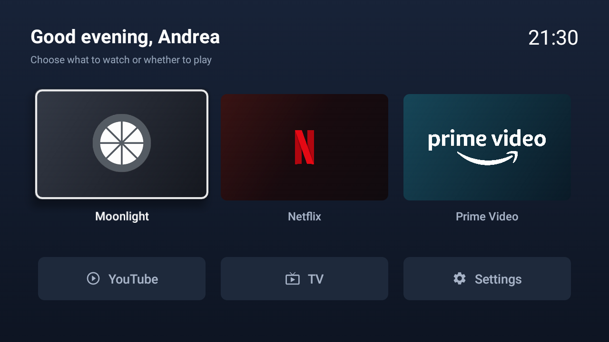

# RyLauncher

Un launcher minimale per Android TV, pensato per avere una schermata
semplice e accesso rapido alle app più utilizzate.

## Funzionalità

- Card dedicate per Moonlight, Netflix e Prime Video.
- Scorciatoie per YouTube, canali TV dell’antenna e impostazioni di sistema.
- Saluto che cambia in base all’ora del giorno.
- Navigazione con telecomando e animazioni di focus sulle card.

## Stato del progetto

Progetto personale in sviluppo, testato su una TV Philips.
Le app mostrate sono attualmente configurate nel codice;
la selezione dinamica e la configurazione come Home predefinita
non sono ancora implementate.

## Anteprima



## Usare RyLauncher come Home

Procedura provata sulla mia TV Philips QM164E.
Il comportamento può variare su altri modelli e firmware.

### Prerequisiti

- RyLauncher installato e funzionante.
- Debug ADB attivo sulla TV.
- Un PC autorizzato e collegato alla TV tramite ADB.
- Activity principale registrata nel Manifest con le categorie
  `HOME` e `DEFAULT`, oltre al filtro `LEANBACK_LAUNCHER`.

### Attivazione

Verifica prima che RyLauncher si apra correttamente:

```bash
adb shell am start -n com.example.rylauncher/.MainActivity
```

Impostalo come Home:

```bash
adb shell cmd package set-home-activity com.example.rylauncher/.MainActivity
```

Sulla mia Philips questo comando restituisce `Success`, ma da solo
non basta: il launcher stock continua ad aprirsi.

Per rendere effettiva la sostituzione, disabilita il launcher stock
per l'utente principale, senza disinstallarlo:

```bash
adb shell pm disable-user --user 0 com.google.android.leanbacklauncher
```

Premi Home sul telecomando e verifica che si apra RyLauncher.
Prima di considerare conclusa la configurazione, prova anche
il ritorno da altre app e un riavvio della TV.

### Tornare al launcher originale

Riabilita il launcher stock, impostalo come Home e aprilo:

```bash
adb shell pm enable --user 0 com.google.android.leanbacklauncher
adb shell cmd package set-home-activity com.google.android.leanbacklauncher/.MainActivity
adb shell am start -n com.google.android.leanbacklauncher/.MainActivity
```

RyLauncher può rimanere installato.

### Precauzioni

- Questi comandi usano i package verificati sulla mia TV.
  Non disabilitare package con nomi diversi senza identificarli.
- Conserva i comandi di ripristino anche fuori dalla TV.
- Durante le prime prove, mantieni disponibile la connessione ADB.
- Prima di disinstallare RyLauncher, riabilita il launcher originale.
- Durante lo sviluppo, preferisci aggiornare l'app senza disinstallarla.
- Non disabilitare servizi Philips, ingressi TV o impostazioni di sistema.
